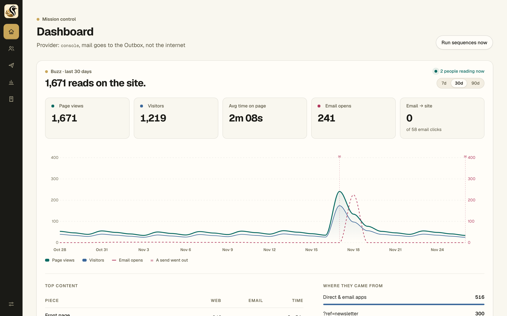
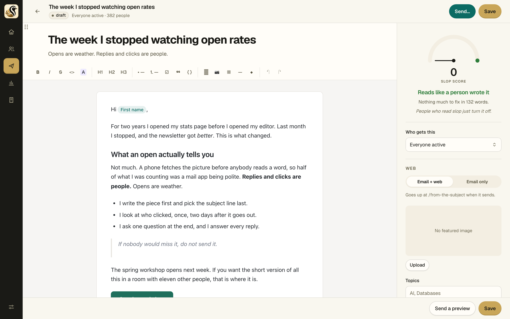
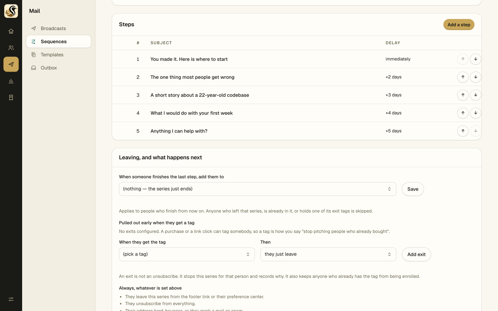
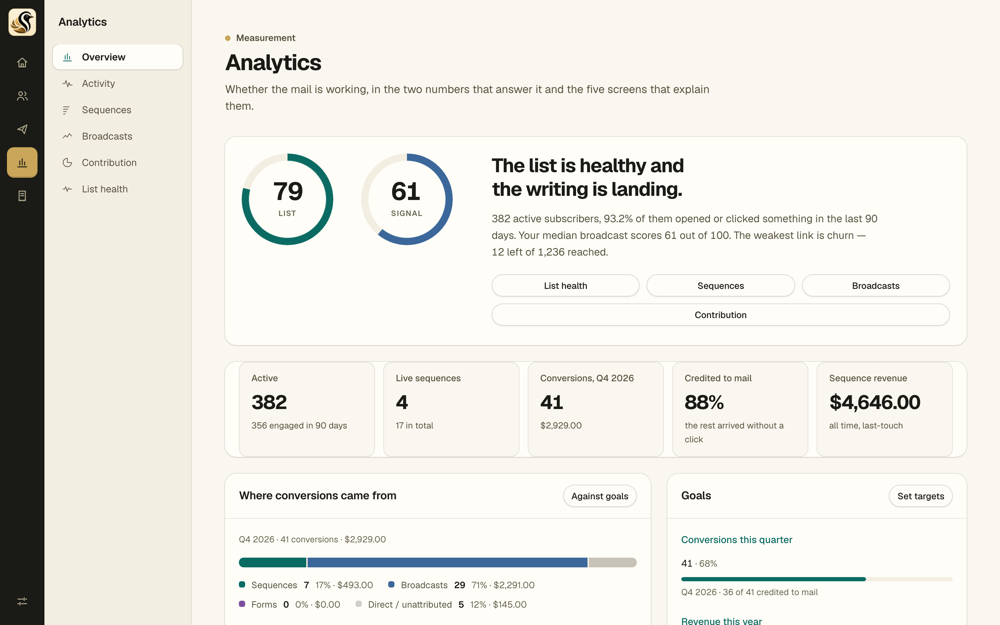
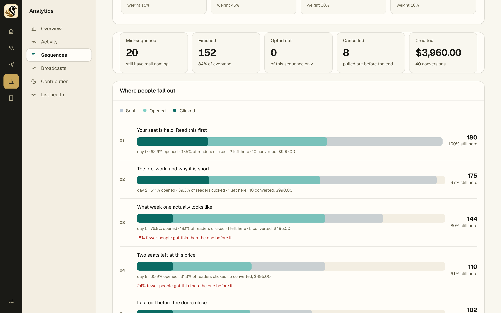
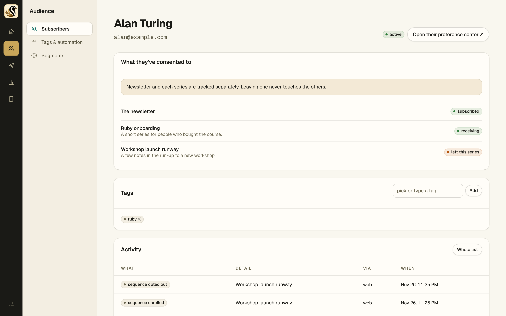
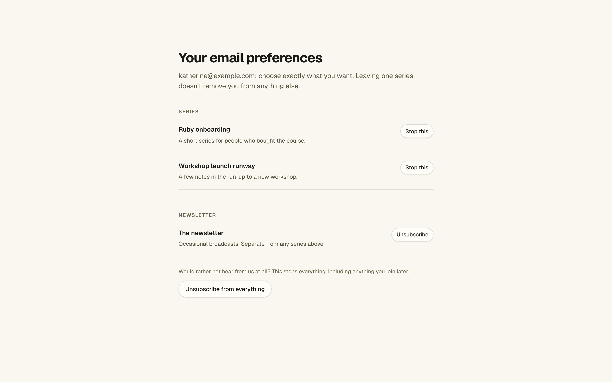
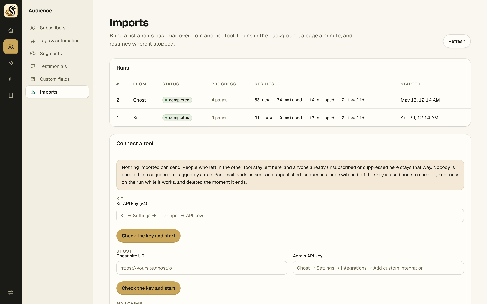
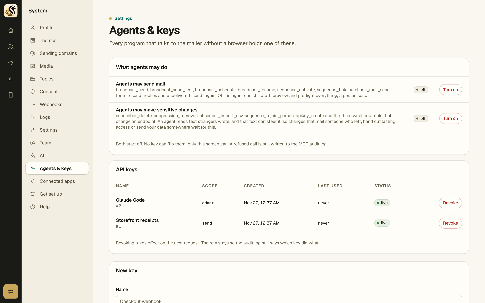
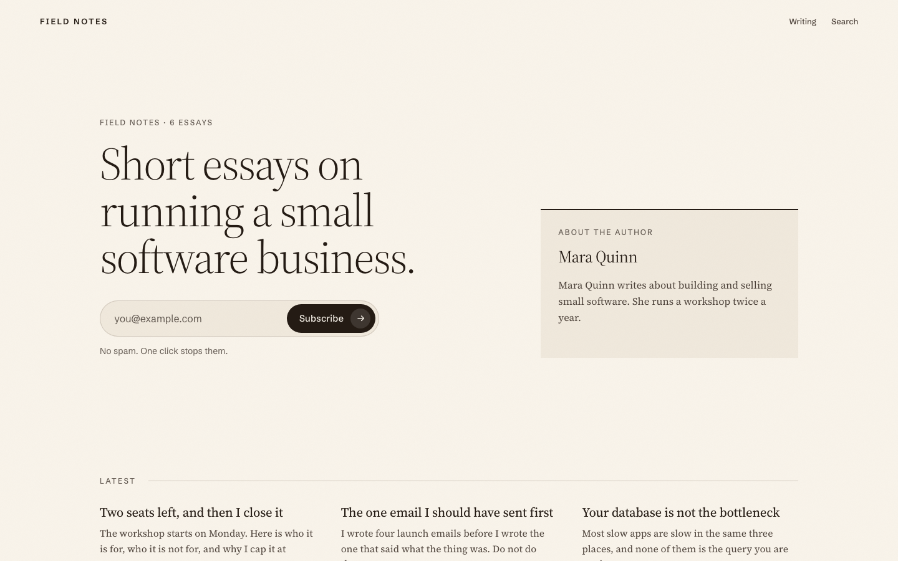

<div align="center">


# Kōlea

**Self-hosted email on one Cloudflare Worker.**
Broadcasts, drip sequences, transactional mail and a blog. The list stays yours.

[](https://github.com/robconery/kolea/actions/workflows/ci.yml)
[](LICENSE)
[](tsconfig.json)
[](https://workers.cloudflare.com/)

[Run it locally](#-run-it-locally) · [Go live](#-put-it-on-your-own-cloudflare-account) · [Tour](docs/TOUR.md) · [Install guide](docs/INSTALL.md) · [Architecture](docs/ARCHITECTURE.md)

</div>



## 🐦 What it is

Kōlea is an email list server you run yourself. It replaces a paid email service
provider (ESP) for one person or one small business: you write in a block editor,
send to a segment, run drip series, and see what worked. Everything lives in your
own Cloudflare account, in a database you can query.

It is for a **single operator**: a writer, a course author, a small software shop.
It is not multi-tenant, it has no drag-and-drop builder, and it does not run its own
mail server. It hands mail to a provider (Resend or Mailgun) and keeps the rest.

Two ideas make it different:

- **Unsubscribing is scoped.** Leaving one series takes a reader off that series and
  nothing else. On most ESPs that click removes them from your whole list, and you
  never find out why the number went down. [More below](#-how-consent-works).
- **The mail is also the website.** A broadcast can go up as a post on your own site
  as it goes out, with a "read this online" link that already works.

The kōlea *(koh-LEH-ah)* is the Pacific golden plover. It flies three thousand miles
of open ocean from Alaska to Hawaiʻi and lands in the same yard every year.

## 🧰 What you need

| To look around locally | To go live, add |
|---|---|
| [Bun](https://bun.sh) 1.2 or newer | A Cloudflare account on the **Workers Paid** plan ($5 a month) |
| [Node](https://nodejs.org) 22 or newer (the local server, wrangler, runs on it) | A domain whose DNS is on Cloudflare |
| About five minutes | A [Resend](https://resend.com) account for sending |

No database to install and no account to create for the local path. Nothing you do
locally can send real mail.

## 🚀 Run it locally

```bash
git clone https://github.com/robconery/kolea.git
cd kolea
bun install
bun run setup
bun run dev
```

1. **`bun install`** fetches the dependencies. You should see a list of packages and
   no errors.
2. **`bun run setup`** gets a fresh clone ready. The repo ships a config template,
   [`wrangler.template.jsonc`](wrangler.template.jsonc), and no config. This command
   writes a local-only `wrangler.jsonc` from it, writes a `.dev.vars` file, and
   creates the local database. You should see three ✅ lines, ending with
   `Local database ready`.
3. **`bun run dev`** builds the editor and starts the server. You should see
   `Ready on http://localhost:8787`. Leave it running.
4. Open **<http://localhost:8787>**. There is no login locally: the local config turns
   the sign-in off. You should see an empty **Dashboard**, with a **Get set up**
   checklist at the top. It ticks itself off as you go, and **Dismiss** puts it away.
5. Click **Seed demo data**. You should see thirteen subscribers, two live series, a
   sent broadcast and a draft. Twelve are demo readers. The thirteenth is you: locally
   you are a made-up operator, Mara Quinn, at `mara@example.com`.
6. Send yourself a test. In the left rail open **Mail** (the paper plane), then
   **Broadcasts**. Open **Draft: everything the editor can do** and click **Send a
   preview**. A dialog should say `Preview sent`, to `mara@example.com`. Then open
   **Mail → Outbox**. Your mail is at the top, fully rendered. It can take five
   seconds to arrive: refresh if it is not there yet. Locally all mail lands in the
   Outbox instead of being sent.
7. See what a reader sees. Open **Audience** (the people icon), then **Subscribers**,
   pick anyone, and click **Open their preference center**. The public site, "Field
   Notes", is at <http://site.localhost:8787>.
8. See how a list comes in. Open **Audience → Imports**. The demo has one finished
   run to read, and the four tools you can connect are listed under it.

To start over, click **Reset data** on the Dashboard. To stop, press `Ctrl+C`.

Run the tests any time. None of these needs the dev server:

```bash
bun run typecheck                  # four TypeScript passes, should print no errors
bun run test                       # the server-side suite, a few seconds
bunx playwright install chromium   # once, for the browser tests
bun run test:ui                    # the browser tests, on their own port and database
```

Stuck? [`docs/INSTALL.md`](docs/INSTALL.md#-troubleshooting) has a troubleshooting
section, and the app has its own manual at **System → Help**.

## ☁️ Put it on your own Cloudflare account

**The guided way.** Open [Claude Code](https://claude.com/claude-code) in the folder
and type `/onboard`:

```bash
claude          # then type: /onboard
```

It needs one thing from you to start: a Cloudflare API token. It tells you where to
make one and which permissions to tick. Then it asks one question at a time and
does this, in order:

1. Checks the token, your domain and the hostnames you picked.
2. Creates the database, two storage buckets and two queues.
3. Puts a Cloudflare Access login in front of the admin, and leaves the reader-facing
   paths open.
4. Writes your `wrangler.jsonc` from the template.
5. Adds your sending domain to Resend and writes its DNS records.
6. Asks **"Ready to push this to production?"** and only then migrates, deploys and
   stores your secrets.

It never sends an email. Your first send is a test to yourself, from the admin. You
can stop at any point and `/onboard` picks up where you left off. The same steps run
without Claude Code as `bun scripts/onboard.ts <step>`.

**By hand.** [`docs/INSTALL.md`](docs/INSTALL.md) walks the whole deploy, with a
checklist to work through before you trust it with a real list. Allow about an hour,
most of it waiting for DNS.

## 🧭 Where to go next

| You want to | Read |
|---|---|
| Know what each screen is for | [`docs/TOUR.md`](docs/TOUR.md) |
| Deploy it, or fix a failed deploy | [`docs/INSTALL.md`](docs/INSTALL.md) |
| Know what it will cost | [`docs/COST.md`](docs/COST.md) |
| Look up a setting or a command | [`docs/CONFIG.md`](docs/CONFIG.md) |
| Change the code | [`docs/ARCHITECTURE.md`](docs/ARCHITECTURE.md), then [`CONTRIBUTING.md`](CONTRIBUTING.md) |

## ✨ What it does

- **Broadcasts.** One-off mail to a segment, written in a block editor with merge
  tags, buttons, images, code and tables. Preview it to yourself, then send.
- **Sequences.** Drip series with delays in days, started by a signup, a tag or a
  form. A reader can leave one without leaving the others.
- **Transactional mail.** `POST /api/send` with a bearer key, for receipts and
  downloads from your other apps.
- **Import from Kit, Ghost, Mailchimp or Drip.** Paste an API key and your list
  and past mail come over in the background. Nobody imported is mailed or enrolled,
  and people who left stay left. See [the tour](docs/TOUR.md).
- **Forms and lead magnets.** A form is a URL any site can post to. It can tag
  people, start a series, hand over a file, and ask for confirmation first.
- **Tags, rules, fields and segments.** "Clicked this link, tag them", and a tag
  can start a series. Custom fields hold a plan or a renewal date. A segment's count
  is the count the send will produce.
- **A public site.** Optional. Sent broadcasts become posts, with search, RSS and
  three built-in themes. Readers can sign in, and a post can be for members or for
  paying members. See [`docs/SITE.md`](docs/SITE.md).
- **Measurement.** Every send gets one score out of 100, compared with your own
  median. Sequences show where readers drop off.
- **Revenue.** Connect Stripe and a sale is credited to the mail that earned the
  click. Offer pages on your site can start the checkout.
- **Agents and an API.** An MCP server in the same Worker, with guards on anything
  that sends, a REST API at `/api/v1`, and signed webhooks out to your other apps.
- **A team, and a record.** Owner, admin and writer roles, a log of what happened
  in plain words, and an audit trail of every change.
- **Writing help.** Optional, off until you add a key. See [`docs/AI.md`](docs/AI.md).

## 🖼 Screenshots

All on demo data, from `bun run screenshots`.

| | |
|---|---|
|  |  |
| **Composer.** A draft, a score for how machine-written it reads, and the Web panel that decides whether it also becomes a post. | **Sequence.** The steps, the days between them, and where finishers go next. |
|  |  |
| **Analytics.** Two scores, because a weak list and weak writing need opposite fixes. | **Sequence report.** How many got each mail, who opened, who clicked, and where people fell out. |
|  |  |
| **Subscriber.** Consent by scope: this reader left one series and still gets the rest. | **Preference centre.** What a reader sees: one switch per series, then the newsletter. |
|  |  |
| **Imports.** A list and its past mail, brought over from Kit, Ghost, Mailchimp or Drip. Nothing imported can send. | **Agents & keys.** What an agent may do is two switches, both off until you turn them on. |



<sub>The public site, in the Folio theme.</sub>

## 🔐 How consent works

There are three scopes, and a narrow choice never turns into a wide one.

| A reader chooses | What stops | What carries on |
|---|---|---|
| Stop this series | That one series | The newsletter and every other series |
| Unsubscribe from the newsletter | Broadcasts | Any series they joined |
| Unsubscribe from everything | All of it, for good | Nothing |

A hard bounce or a spam complaint also stops everything. Transactional mail, such as
a receipt, ignores marketing consent and is blocked only by a dead address or a
complaint.

Consent is checked again right before each mail is handed to the provider, so someone
who opts out a minute before a send is not mailed. An unsubscribe is permanent: no
import or sync can make that person active again. The details are in
[`docs/HOW-IT-WORKS.md`](docs/HOW-IT-WORKS.md).

## 💸 What it costs

Running it locally is free. A live install is two flat fees for most lists:

| | Cost |
|---|---|
| Cloudflare Workers Paid (the app, database, queues, schedules) | $5 a month |
| Resend Pro (sending, up to 50,000 emails a month) | $20 a month |
| Cloudflare R2 storage and Zero Trust login | Free at this size |
| Stripe, Unsplash, OpenRouter | Optional |

There is no charge per subscriber, so 500 readers and 15,000 readers cost about the
same. [`docs/COST.md`](docs/COST.md) has the tiers, the limits and worked examples.

## 🤖 Drive it from an agent

The Worker serves an [MCP](https://modelcontextprotocol.io) server, so an agent such
as Claude Code can cut segments, draft broadcasts, build sequences and read results.

```bash
claude mcp add --transport http --scope local \
  --header "Authorization: Bearer $KOLEA_KEY" \
  kolea "http://localhost:8787/mcp/$MCP_PATH_SECRET"
```

Locally, `MCP_PATH_SECRET` is in the `.dev.vars` file that `bun run setup` wrote, and
**Seed demo data** prints an admin key once. You can also add it by URL and approve
it in the browser, with no key to copy. An agent can read and draft freely. Sending
needs a one-time preflight token that any edit cancels, and agents cannot send at
all until you turn that on at **System → Agents & keys**. Every call is recorded.
See [`docs/MCP.md`](docs/MCP.md).

## 📚 Docs

| | |
|---|---|
| [`docs/TOUR.md`](docs/TOUR.md) | Every screen, the words the app uses, how it measures, the editor |
| [`docs/INSTALL.md`](docs/INSTALL.md) | Local setup, the full production deploy, troubleshooting |
| [`docs/CONFIG.md`](docs/CONFIG.md) | Every setting and command, the code layout, swapping the mail provider, tests |
| [`docs/COST.md`](docs/COST.md) | What each service costs and which tier you need |
| [`docs/SITE.md`](docs/SITE.md) · [`docs/templates.md`](docs/templates.md) | The public site, and how to write a theme |
| [`docs/MCP.md`](docs/MCP.md) · [`docs/AI.md`](docs/AI.md) | Agents, and the optional writing help |
| [`docs/HOW-IT-WORKS.md`](docs/HOW-IT-WORKS.md) | Consent, how a send goes out, and the design decisions |
| [`docs/ARCHITECTURE.md`](docs/ARCHITECTURE.md) · [`docs/SPEC.md`](docs/SPEC.md) | The full reference and the numbered requirements |
| [`docs/PROJECT.md`](docs/PROJECT.md) · [`docs/PLAN.md`](docs/PLAN.md) · [`docs/STORIES.md`](docs/STORIES.md) | Scope, build status and the user stories |
| [`CHANGELOG.md`](CHANGELOG.md) | What changed, written for someone who runs it. Read it before you pull |

## 🤝 Contributing

Bug reports, correctness fixes and email-client rendering fixes are welcome. Read
[`CONTRIBUTING.md`](CONTRIBUTING.md) before opening a pull request, and report a
vulnerability privately as [`SECURITY.md`](SECURITY.md) describes. Multi-tenancy, a
drag-and-drop builder and self-run SMTP are out of scope on purpose. Forking is
encouraged: the code is small enough to read end to end. Participation is covered by
the [Code of Conduct](CODE_OF_CONDUCT.md).

## 👋 Who makes this

Kōlea is built by Rob Conery. He teaches senior developers to build with AI agents
at [Big Machine](https://bigmachine.io/?ref=kolea-repo). This repo was built that
way, and its [`.claude/`](.claude/) commands and [`docs/`](docs/) show the method. If
you would rather not run it yourself, the hosted version is at
[kolea.pro](https://kolea.pro/?ref=kolea-repo).

## 📄 License

[MIT](LICENSE) © Rob Conery

<div align="center"><sub>🐦 <b>Kōlea</b>: three thousand miles, same yard, every year.</sub></div>
