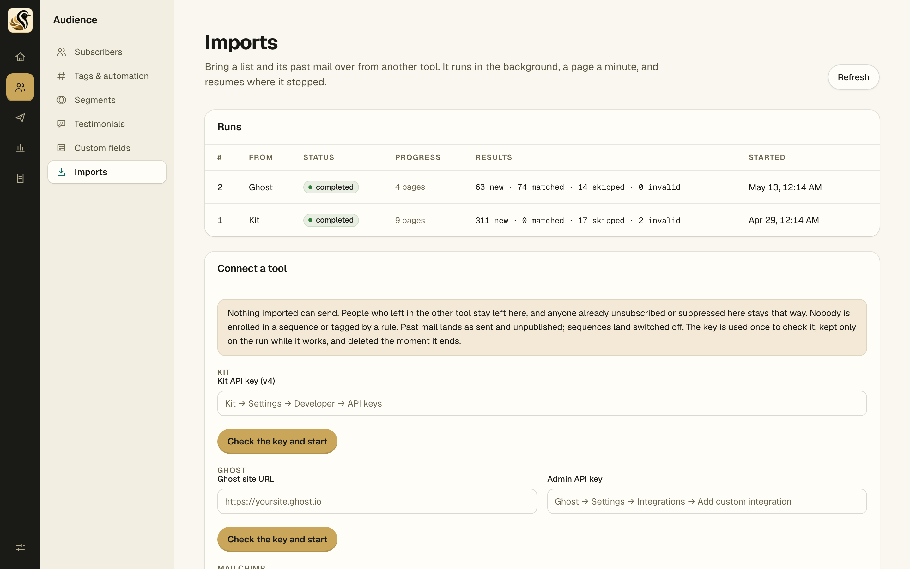
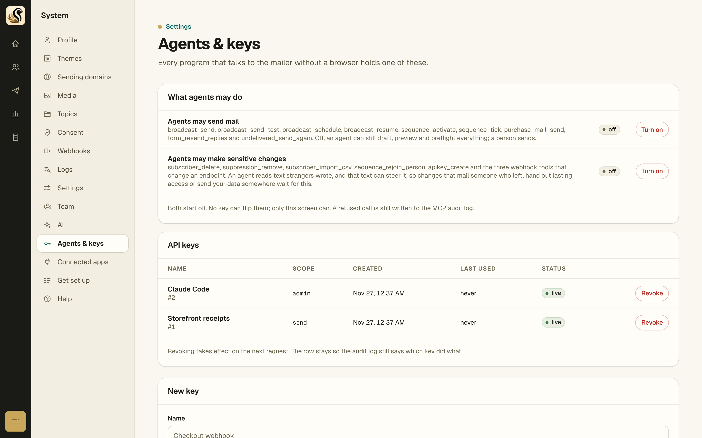
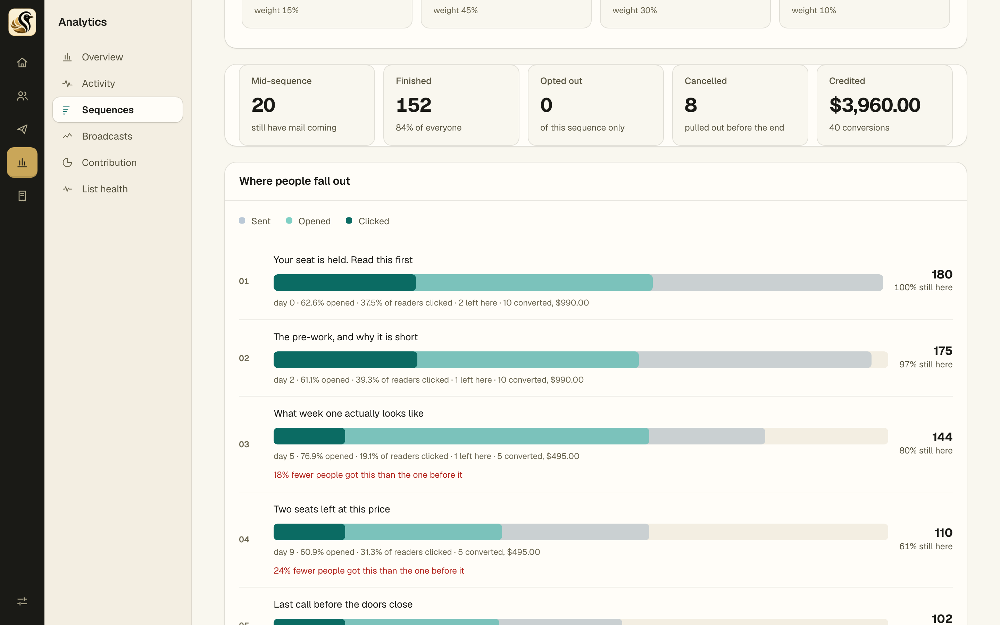

# 🧭 A tour of Kōlea

What every screen is for, the words the app uses, how it measures, and the editor.
The app also carries its own manual at **System → Help** (`/help`), with every URL and
`curl` filled in for wherever you are running it.

## 🎯 Try the thing it's for

1. **Subscribers** → pick someone → **Open their preference center**
2. Add `?scope=sequence:2` to that URL. This is what a link inside a sequence email
   looks like.
3. Hit **Stop just this series**
4. Go back to their subscriber page: still `active`, still on the newsletter, out of
   exactly one series
5. **Consent** shows everyone who left a single series versus the (empty) list of
   people gone entirely

Send a broadcast afterwards and they'll still receive it. That's the whole argument.

Sequence delays are in **days**, and the first step defaults to 0 (arrives on join)
while later steps default to 1. Which means a seeded series won't finish while you
watch it, so the dashboard has **Fast-forward the clock** (local only): it pulls every
pending step to now and runs a tick. Use it and you'll watch step 2 skip the people
who left that series.

---

## 🧭 A tour of the console

Everything in the left rail, top to bottom, and what it's for. There's also a manual
built into the app at **System → Help** (`/help`), with every URL and `curl` already
filled in for wherever you're running it.

### 🏠 Dashboard

Where the list stands today: readers on the site against mail going out, the last send
and its score, who's on the list, who left what, and what's in draft. The **Consent, by scope** panel is the one to look at. It separates people who
left one series from people who left everything. Locally, it's also where **Seed demo
data**, **Fast-forward the clock** and **Reset data** live. On a new install the
**Get set up** checklist sits here too, until every step is done or you dismiss it.

### 👥 Audience

| Screen | What it's for |
|---|---|
| **Subscribers** | Everyone you know about. Open anyone to see their tags, their custom fields, their sequences, every mail they got and what they did with it, and a link to their preference center exactly as they'd see it. CSV import is here too, and a column headed with a custom field's key fills that field. |
| **Clean up** | A button on Subscribers. Pick the groups to prune: never opened, unsubscribed, bounced or complained, never confirmed. You see the counts, download a backup CSV of exactly those people, then type the count to confirm. Buyers and anyone with mail queued are never included. Anyone who bounced or complained stays suppressed, and anyone who left the newsletter stays off it if you import them again, until they sign up again themselves. |
| **Tags & automation** | Tags are facts you store about people. *Automation* is tag rules: "clicked this link → tag them", and a tag can start a sequence. That chain (click, tag, enroll) is how someone who shows interest gets the follow-up without you doing anything. |
| **Segments** | Saved questions about the list ("tagged `customer`, not tagged `ruby`, joined this year"). A broadcast goes to a segment. The count you see is the count the send will produce, from the same function. |
| **Testimonials** | What readers wrote through `{{testimonial_link}}` in your mail. Each reader gets their own link to a short form, and ticks whether you may publish what they wrote. Approve, hide or delete here. Approved ones show on the site's `/testimonials` wall. |
| **Custom fields** | Named, typed facts a person carries: text, number, date or yes/no. Ask about them in a segment, or put them in mail as `{{key}}`, or as `{{key\|fallback}}` for people with no value. The key never changes once made, so segments and mail that use it keep working. The name can change any time. |
| **Imports** | Bring a list and its past mail over from another tool. See the next section. |

#### 📥 Import from Kit, Ghost, Mailchimp or Drip



Open **Audience → Imports**, fill in the tool's API key, and click **Check the key and
start**. Ghost also asks for your site URL, Mailchimp for the audience ID, and Drip for
the account ID. The import runs in the background, one page a minute, and resumes
where it stopped. One import runs at a time. You can cancel a run, and the rows it
already wrote stay.

The key is checked once, kept on the run only while it works, and deleted when the run
ends, whether it finished, failed or was cancelled. The screen never shows it back.

| From | What comes over |
|---|---|
| **Kit** | Tags, subscribers with their fields, sent broadcasts with Kit's numbers, and sequences with their mails. |
| **Ghost** | Members, with their labels as tags, and every post Ghost published or emailed, with its newsletter numbers. |
| **Mailchimp** | One audience: its members with their tags and merge fields, and its sent campaigns with their report numbers. |
| **Drip** | Tags, subscribers with their tags and custom fields, and sent broadcasts. Drip reports no numbers for them. |

Field values are kept on the person as text. Add a custom field with the same key to
use one.

**What an import never does:**

- Nothing imported can send. Past mail lands as sent and unpublished. Sequences land
  switched off, with nothing set to start them.
- People who left in the other tool stay left here. An unsubscribe, a bounce or a
  complaint arrives with the same reach the tool gave it, never wider.
- Anyone already unsubscribed or suppressed here stays that way. An import never moves
  a person who is already here toward more mail.
- Nobody is enrolled in a sequence or tagged by a rule.
- A status Kōlea does not recognise imports nobody.
- Running it twice copies no broadcast or sequence twice.

**What it leaves behind:**

- Drafts and scheduled mail.
- Ghost's post tags. They do not become topics.
- Mailchimp automations and journeys, and Drip campaigns (email series). Their APIs do
  not hand over the mail. Rebuild them as sequences.
- Kit's sequence triggers. Kit keeps them in automations its API does not expose.
- Mailchimp contacts that are transactional or archived.

Each run has a report: how many people were new, matched, skipped or invalid, a **By
kind** table, and a **Worth knowing** list that says what was left out and why. CSV
import is still on the Subscribers screen.

### ✉️ Mail

| Screen | What it's for |
|---|---|
| **Broadcasts** | One-off mail to a segment: the newsletter. Write it in the block editor, send yourself a test, then send it. (An agent can schedule one through MCP; the admin has no date picker yet.) The **Web** panel beside the editor decides whether it also goes up as a post on your public site, and holds its excerpt, featured image and topics. **Who can read it** in that panel opens the post to everyone, to members, or to Premium members. That choice is for the web only: the mail still goes to its whole segment. With writing help switched on, the **Ghostwriter** and the **Reader council** sit beside the draft. |
| **Sequences** | Drip series: a list of steps with a delay in days between them, started by a form, a tag or a signup. People can leave one series without leaving anything else. A sequence is created paused; activating it is a deliberate click. **When it sends** keeps a sequence's steps to the hours of the day you choose. A step that comes due outside the window waits for it to open and is never skipped. The time zone is picked on the same card, starts as UTC, and every sequence uses it. **Ghostwriter takes** drafts every mail beside the sequence for you to read, one mail at a time. |
| **Templates** | Starting points for a sequence: staples like a welcome series, launches, funnels. With AI help switched on, "Make it yours" drafts the whole series for you to rewrite. |
| **Ghostwriter** | The voice the Ghostwriter drafts in: six influence sliders, the length and structure of a mail, how finished the draft is, and whether it reads your last two sent broadcasts to sound like you. It never sends, activates or publishes. See [`AI.md`](AI.md). |
| **Transactional** | Stored templates your other apps send by slug through `POST /api/send`, with `{{variables}}` the request fills in. A request that leaves a variable out is refused. These carry no unsubscribe footer and no tracking, and only a hard bounce or a spam complaint stops one. |
| **Outbox** | Every mail rendered while `EMAIL_PROVIDER=console`, exactly as it would have gone out: footer, merge tags, tracking links. Locally this is where all mail goes. In production it's your kill switch's landing pad. |
| **Undelivered** | Mail that should have gone and did not: the queue gave up on it, or the provider refused it. Fix what stopped it, then **Send again**. Consent is checked again first, and nobody who already got the mail gets it twice. Mail that may have arrived (the provider took it, or nobody can tell) is listed apart under **Check before sending**. It is never part of a bulk resend. You send those one message at a time, after ticking that you checked. |

### 📊 Analytics

Read-only, all of it. No screen here can send or change anything. See
[Measurement](#-measurement) below for the reasoning behind each one.

| Screen | The question it answers |
|---|---|
| **Overview** | Is the list healthy, and is the writing good? Two separate dials, because they need opposite fixes. |
| **Activity** | What happened, in order: signups, tags, enrollments, opt-outs, purchases. The only screen that shows events rather than totals. |
| **Sequences** | Which series people finish, where they drop off, and what each one earned. |
| **Broadcasts** | Every send scored against *your own* median, not an industry number. |
| **Contribution** | Which mail actually moved a goal. |
| **List health** | Growth, engagement, churn, delivery and money, each with a sentence on what to do. |

### 💳 Money

These fill in once Stripe is connected. Without it they're empty, and everything
else works fine.

| Screen | What it's for |
|---|---|
| **Campaigns** | A named push ("spring launch") that broadcasts, sequences and forms can belong to. A click on campaign mail counts as a *touch*, and a sale after a touch is credited to it. |
| **Launch Studio** | One push to sell one thing, in seven steps: describe the offer, plan the launch, open a campaign, build the sequence, write the copy, take it live, review the launch. It builds a campaign and a paused sequence. You take them live on their own screens. See [`AI.md`](AI.md). |
| **Forms** | Signup endpoints. A form is a URL you post a plain HTML `<form>` to, from any site. It can tag people, start a sequence, and hand over a file (a lead magnet) by email. Every file also has a direct link you can send to anybody yourself. A form can ask people to confirm by email first (double opt-in): the tags, the sequence and the reply wait for the click. New forms start with it on. Forms made before the switch existed stay off until you turn it on. If a form's replies failed to send, its page lists who never got one and sends the reply again, once per person. |
| **Sales** | Every Stripe charge, and which mail gets the credit. Anything with no click in the window is `direct`, which is usually the honest answer. |
| **Import sales** | Past sales from a CSV, so revenue covers the years before Stripe was connected. Up to 100 lines a file, and uploading the same file twice books nothing twice. An import never sends mail, tags anyone or starts a sequence. |
| **Members** | Readers who sign in on the site, who pays for Premium, and the post that converted them. The monthly and yearly Premium prices are picked here. See [`SITE.md`](SITE.md). |
| **Purchase mail** | What a buyer is sent after they buy, per product. Sending it is a button you press on a sale; the webhook never mails anyone by itself. |
| **Goals** | Targets over a named period: "30 cohort signups in Q2". |
| **Conversions** | The events counted against goals. One per sale, the first matching kind wins. |
| **Store** (overview, offers, customers, segment ideas) | What sells and who buys it. *Segment ideas* proposes audiences from what people actually bought, sized with the same count a send would use. |
| **For sale** | Which products from your Stripe catalog the site sells. Each one you put on sale gets its own page under `/offers` with a Buy button. Recent checkouts are listed with the post that sent the buyer. |

### ⚙️ System

| Screen | What it's for |
|---|---|
| **Profile** | Who the public site is about: name, photo, short bio, the /about page, social links. Themes read it; switching themes never loses it. |
| **Themes** | How the public site looks. Three built-in (Folio, Signal, Nightdrive), or install a zip. Preview against your real posts, then switch. See [`docs/templates.md`](templates.md) to make your own. |
| **Sending domains** | The domains your mail is sent from, the DNS records each one needs, and whether they are in place. With `CLOUDFLARE_DNS_API_TOKEN` set, **Add to Cloudflare** creates the missing records for you. |
| **Media** | Every image you uploaded, whichever screen it came in by: the editor, a featured image, the profile, or this one. Deleting an image that is still in use names where, then asks again. |
| **Topics** | What the site's posts are about. A post's first topic is the first part of its URL, and each topic has its own archive page. Give a topic a name and a description, and tick the ones that get a shelf on the front page. Topics are not subscriber tags and never send anything. |
| **Consent** | Everyone who left a single series, set side by side with everyone who left entirely. |
| **Webhooks** | Tell your other systems when something happens on the list: subscribed, unsubscribed, bounced, complained, purchased, published. Every request is signed with the endpoint's secret, a failed one is retried up to eight times, and each endpoint keeps a log of its deliveries. |
| **Logs** | Everything the mailer did and saw in the last 90 days, in plain words: who joined and left, what went out, what failed or was held back, what Stripe told it, and every action taken in the console. Filter by kind, or search. |
| **Settings** | Which provider is live, the `PUBLIC_URL` baked into mail, and how to call the transactional API. Check it after every deploy. |
| **Team** | The people who can use this console, and as what: owner, admin or writer. A writer writes and edits broadcasts, posts and sequences, and cannot send, schedule, switch a sequence on or change settings. The role goes on the address a person signs in with through Cloudflare Access, so add them to the Access policy as well. Kōlea sends no invitation mail. |
| **AI** | Which key pays for the writing helpers, and which model each one uses. See [`AI.md`](AI.md). |
| **Agents & keys** | The API keys for every program that talks to Kōlea without a browser, in three scopes: `send`, `read` and `admin`. Two switches decide what an agent may do: send mail, and make sensitive changes such as deleting a subscriber or creating a key. Both start off, and only this screen can turn them on. |
| **Connected apps** | Agents you added by URL. Paste your `/mcp` address into Claude or another MCP client, then approve it here. Disconnect one and its tokens stop working at once. |
| **Get set up** | The first-run checklist: six steps, in any order, each done on the screen that owns it. Nothing on it sends mail or turns anything on. It lives here as well as on the Dashboard, so dismissing it there never loses it. |
| **Help** | The in-app manual. |



<sub>**Agents & keys**, on demo data. A call that is refused is still written to the MCP
audit log.</sub>

### 🌐 Pages your readers see

None of these are behind your login. They can't be, or the mail you've already sent
stops working.

| Path | What it is |
|---|---|
| `/p/…` | The preference center. The unsubscribe link in every mail lands here, with the *narrow* choice first. |
| `/p/…/testimonial` | Where a reader writes a testimonial, reached from their own `{{testimonial_link}}`. |
| `/f/<slug>` | Where your signup forms post. |
| `/d/…` | Lead-magnet downloads. The link itself is the permission. |
| `/t/…` | Open pixels and click redirects. |
| `/media/…` | Images inside your mail. |
| Your site host | The public blog, if you turned it on. It also carries member sign-in (`/members`), Premium (`/premium`), offer pages (`/offers`) and the testimonials wall (`/testimonials`). See [`SITE.md`](SITE.md). |

---

## 📖 The words used here

| Word | Means |
|---|---|
| **Broadcast** | One piece of mail to a segment, sent once. Also a post, if you publish it. |
| **Sequence** / **step** | A drip series, and one mail in it. Delays are whole days. |
| **Enrollment** | One person's progress through one sequence. |
| **Segment** | A saved rule that picks people. Evaluated at send time. |
| **Tag** / **tag rule** | A label on a person / an "when X happens, tag them" automation. |
| **Custom field** | A named, typed fact about a person, such as a plan or a renewal date. Its key is its merge tag. |
| **Topic** | A label on a post, for the public site. Not a subscriber tag, and it never sends anything. |
| **Form** | A public URL that turns a POST into a subscriber, with consent recorded. |
| **Double opt-in** | A form setting. The signup gets one mail with a confirm link, and nothing else happens until they click it. |
| **Lead magnet** | A file a form hands over. Lives in its own bucket, and leaves by a per-person link in the reply or by the form's one direct link, which you hand out yourself and can reset. |
| **Campaign** / **touch** | A named push / a click on its mail, which is what earns it credit for a sale. |
| **Conversion** / **goal** | Something that happened (a sale, a signup) / a target you set for a period. |
| **Opt-out** | Leaving *one* sequence. Everything else carries on. |
| **Unsubscribed** | Leaving the newsletter (broadcasts). Series you joined carry on. Permanent: no import brings you back. |
| **Suppression** | Off everything, forever. Written by "unsubscribe from everything", a hard bounce, or a spam complaint. |
| **Transactional** | Receipts and downloads sent by your other apps through `/api/send`, as a whole mail or by naming a stored template. Ignores marketing consent, and only a hard bounce or a spam complaint stops one. |
| **Member** / **Premium** | A subscriber who signed in on the public site / a member with a paid monthly or yearly subscription. |
| **Take** | The Ghostwriter's draft of every mail in a sequence, kept beside the sequence until you use a mail from it. |
| **Machine open** | An open-pixel fetch by software, not a reader: Apple Mail Privacy Protection, a link scanner, a prefetcher. Counted apart. |
| **Provider** | What puts mail on the wire. `resend` for real, `console` for the Outbox. |
| **Kill switch** | Setting `EMAIL_PROVIDER=console`. Mail renders into the Outbox instead of going out. |
| **Preflight** | The one-time token an agent must fetch before it can send, which any edit invalidates. |
| **Signal** | The 0 to 100 score for a send, the same scale for broadcasts and sequences. |
| **Operator** | You, the owner. **Team** can add others as owner, admin or writer. Cloudflare Access is what knows who each person is. |

---

## 📊 Measurement

An ESP will happily show you an open rate and let you draw your own conclusions. The
five screens under **Analytics** exist because a mailing list is the one asset here you
cannot inspect by looking at it: you can read every broadcast you ever wrote and still
have no idea whether the list is healthy, and no amount of staring at a sequence tells
you which mail in it loses people.



<sub>The step waterfall for one sequence, on demo data. Retention is measured against **step one**, never
against the previous step. Chained ratios hide a slow bleed across six mails behind six
unremarkable-looking numbers.</sub>

| Screen | The question |
|---|---|
| **Overview** | Two dials: the health of the list, and the median score of the writing. A healthy list carrying weak sends and a weak list carrying great sends look identical on any single number, and they want opposite responses. |
| **Sequences** | Every series ranked, with the two things a rate can't tell you: who finishes, and what it earned. Flags series switched off with people still inside them. |
| **Broadcasts** | Every send scored against **your own median**, which is the only benchmark that survives contact with reality. |
| **Contribution** | Which mail actually moved a goal: by channel, and by the individual broadcast or sequence that earned the credit. |
| **List health** | Growth, engagement, churn, delivery and money, each with the sentence saying what to do about it. |

Every figure on these screens carries the two integers underneath it, because a rate
with no denominator is how dashboards mislead people who trust them. **Nothing here
writes**: no forms, no POST routes, by construction. An analytics page that can send
mail is one misclick from mailing the whole list.

**Machine opens are counted apart.** Apple Mail Privacy Protection, link scanners and
prefetchers fetch the open pixel whether or not anyone reads the mail. Kōlea still
records those opens, flags them as machine, and leaves them out of the opened counts
on these screens. A broadcast's report shows them on their own line, such as
`+ 12 machine opens, not counted`. A machine open fires no tag rule and starts no
sequence. Gmail's and Outlook's image proxies fetch when the reader opens the mail, so
they count as people. Only opens are judged: a click is always trusted.

```bash
bun scripts/seed-analytics-demo.ts     # local only, and there is no --remote flag
```

That seeds a world worth looking at: demo people spread over a year, two live sequences
with real message and event history, imported broadcasts, conversions and a couple of
goals. `--clean` removes every row of it again.

---

## ✍️ The editor

Block-style rich text, TipTap v3, vanilla (no React). Open the seeded draft
**"Draft: everything the editor can do"** to see the lot.

- `/` on a line → block menu: headings, lists, checklist, quote, code, table, toggle,
  divider, image, image from your media library, YouTube, CTA button
- `@` → personalization fields as real nodes, so `first_name` can't be misspelled. Your
  custom fields are in the same list
- Drag the handle in the left margin to reorder; shift-select spans multiple blocks
- Drop or paste an image anywhere → uploads to R2, inserts when the URL returns
- Code blocks are syntax-highlighted (15 languages, incl. Ruby, Elixir, TS, SQL)
- Select text for the bubble menu; select a **button** and the bubble menu becomes its
  URL and colour picker

**Buttons and merge tags are custom nodes** built specifically for email. A CTA renders
as a nested table, and every style is inlined. A merge tag is a node rather than raw
`{{first_name}}` text, because a typo in raw text mails "Hi {{frist_name}}" to the
entire list.

A custom field can also be typed as text, `{{plan}}`, and a tag can carry a fallback
after a bar for people with no value: `{{plan|free}}`. `{{testimonial_link}}` is typed
as text too, usually as the URL of a button or a link. In a broadcast or a sequence
mail it becomes that reader's own link to write a testimonial. On the public post it
points at the `/testimonials` wall. In transactional mail it resolves to nothing.

Bodies are stored as TipTap JSON in `body_json`. Legacy markdown in `body_md` still
renders and is converted the moment you open it in the editor. Nothing is migrated in
bulk, because a bulk migration that goes wrong takes the archive with it.

The client bundle is ~226KB gzipped and loads only on the two screens that compose
mail. Everything else in the admin console is server-rendered with zero JavaScript.

There's a browser smoke test (`bun run smoke`, 33 checks) driving real Chromium,
because a renamed extension option fails silently in the browser and the body field
just never saves. Nothing server-side can catch that.

---

[Back to the README](../README.md)
